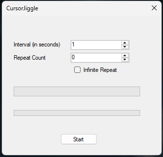
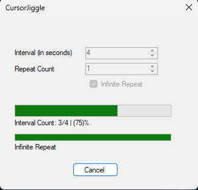

# Cursor Jiggle

This program was built as a personal project using Visual Studio and C#.
I made it because I wanted to try coding a program which periodically moves my mouse cursor to prevent my screen from sleeping.

## How it works
The program uses the BackgroundWorker component of Windows Forms to act a timer that waits until a interval is reached.
Then, it moves the mouse cursor using the built-in Cursor Class. 

## Screenshots

   
   

